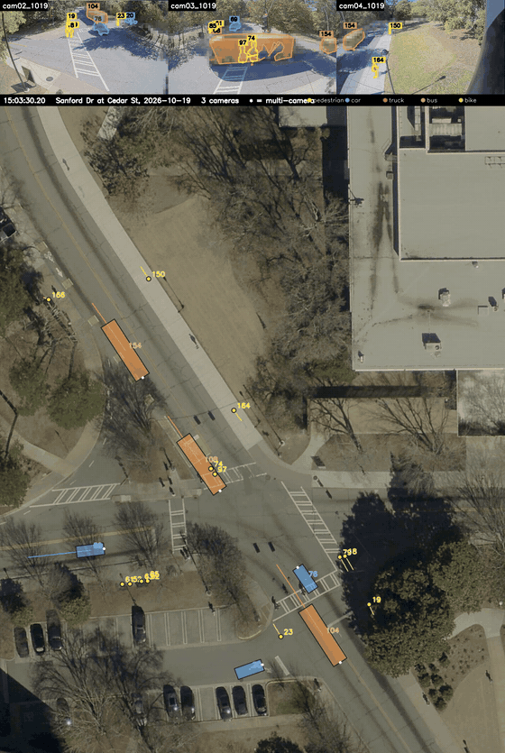
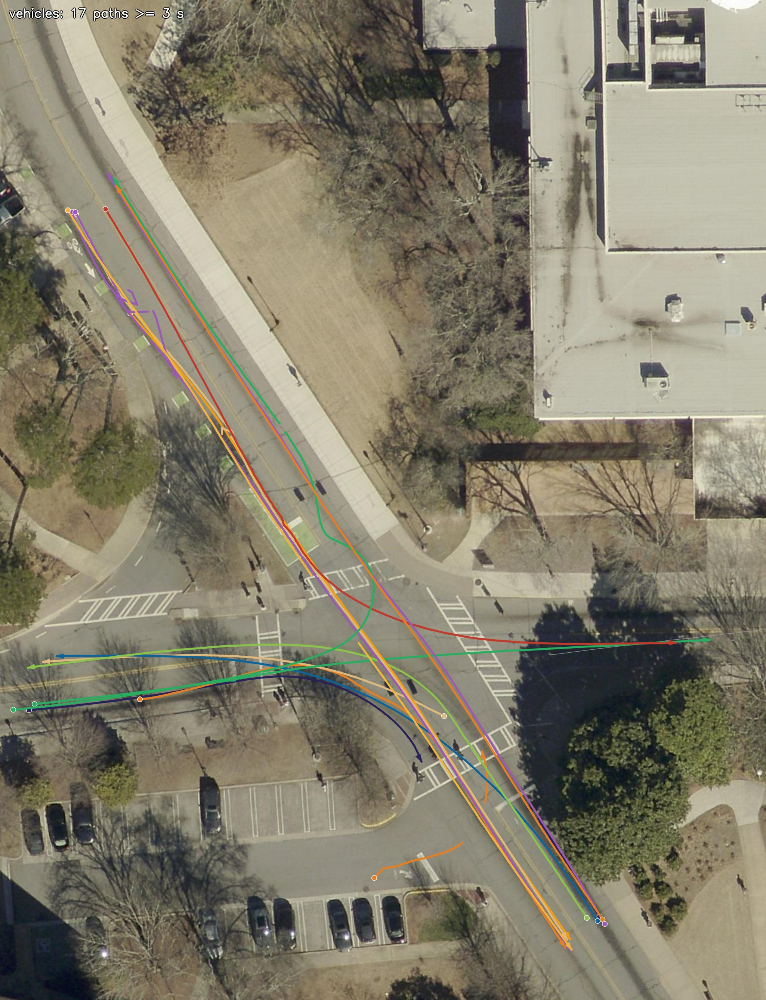
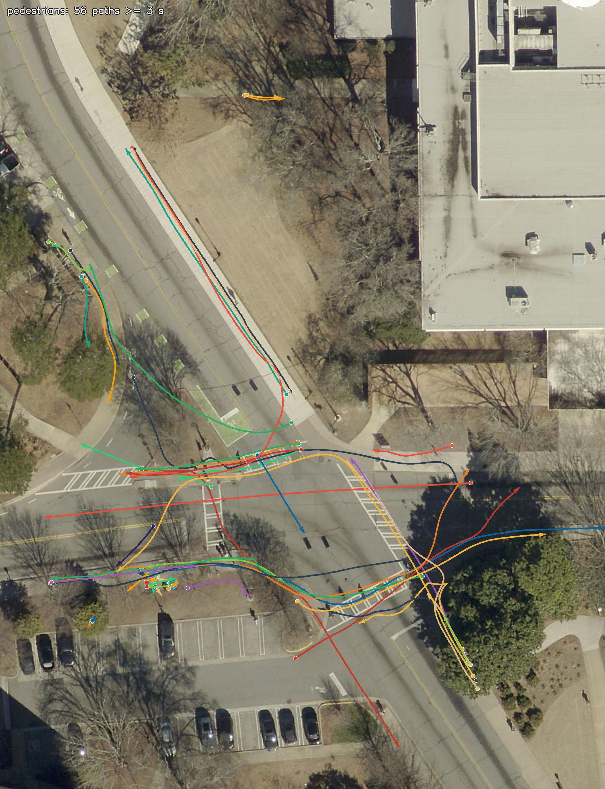
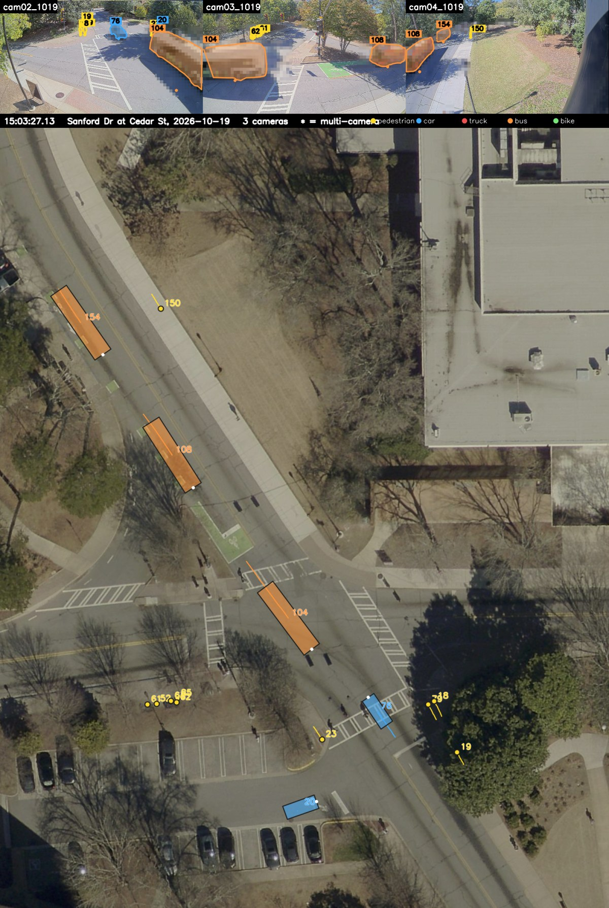
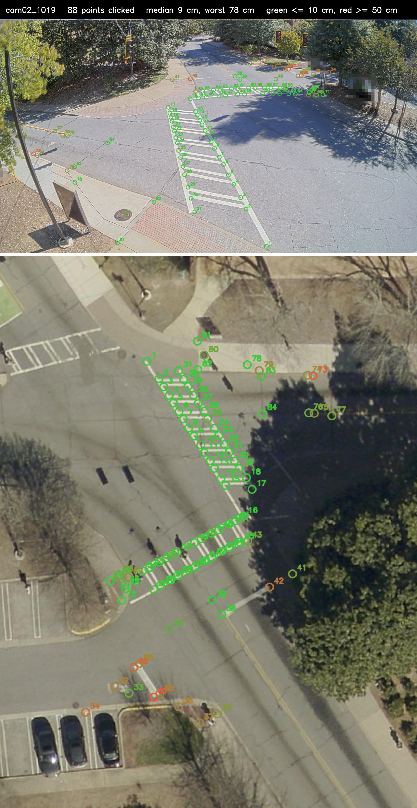
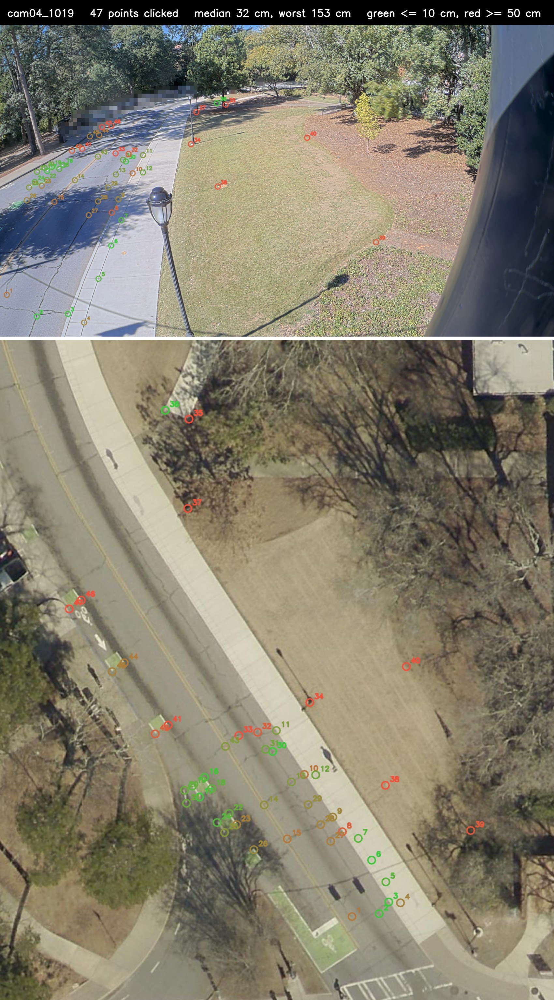
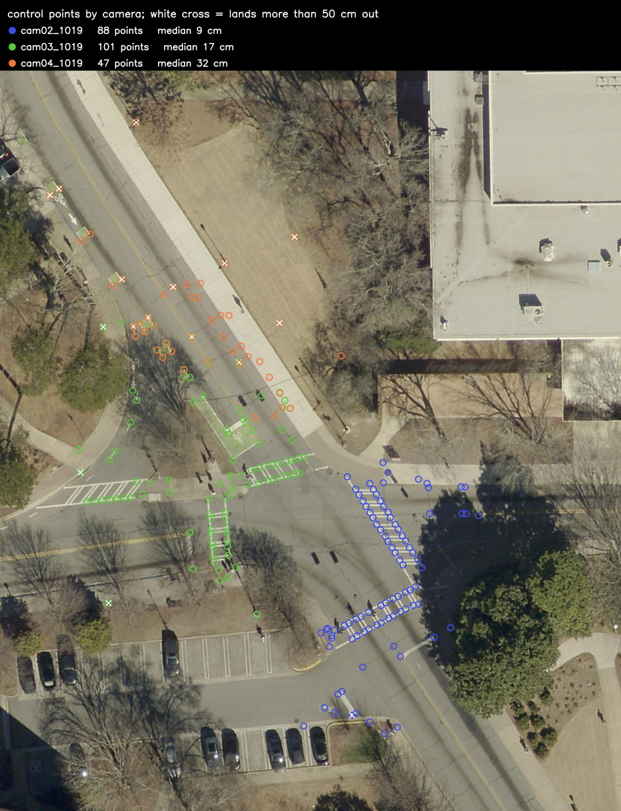

# CurbSight

Roadside cameras to one map. Several cameras on one pole watch an intersection; this turns what they
see into one set of trajectories on the ground, in metres, with each road user carrying a single
identity across every view.

Everything here runs on a two-minute sample from three cameras, whose detections and trajectories are
in `sample/`. The recordings themselves are not published (see [Privacy](#privacy)). The accuracy
figures below were measured against a survey-grade GNSS track and a lidar, not estimated.



*Thirteen seconds of it. Three camera views along the top, one map below. The same bus, the same
pedestrian, one identity each, wherever they are. Every detected person and vehicle is pixelated in
the camera views. The whole two minutes are in [`figures/fused_demo.mp4`](figures/fused_demo.mp4).*

## 83 road users in two minutes



*Every vehicle path in the sample that lasts at least 3 seconds: 17 of them. Dot = where the track
starts, arrow = where it ends.*



*The same two minutes, pedestrians: 56 paths. Eighty-three road users in a hundred and twenty
seconds, on a university campus at three in the afternoon.*

## Conflicts from time to collision and post-encroachment time

Two standard surrogate safety measures are computed from the same trajectories.

- **Time to collision (TTC).** At each frame, the time until a moving vehicle's body would reach
  another road user if both kept their current velocity.
- **Post-encroachment time (PET).** When two road users pass through the same square metre of
  ground, the time between the first leaving it and the second arriving. It is counted only where
  the two paths cross or merge.

PET belongs to paths that meet. Each pair that passes through the same square metre within 5 s is
therefore given a type first, the way published tools type an encounter (`pipeline/encounter_type.py`).
SUMO's safety device [7] sorts encounters into lead and follow, merging and crossing by the lanes
used before and after the conflict point, and computes no PET for lead and follow. FHWA's SSAM [8]
calls a conflict rear end under 30 degrees and crossing over 80 degrees. The trajectories here carry
no lane number, so the lane is read from the paths:

| Type | Rule | PET |
|---|---|---|
| following | the second road user approached along the path the first one drove, within 3 m and 30 degrees, whatever the first one does afterwards | not counted, a matter for TTC |
| oncoming | opposite directions, and the second one's path does not cross the first one's near the place in the next 10 s | not counted: the two bodies only reach the same square metre at the centre line |
| merging | different paths before the place, the same lane after it | counted |
| crossing | everything else: paths from different directions that cross and separate | counted |

Each counted encounter then gets a severity level from its smallest value, by the pair of road
users involved.

### Severity levels and their sources

| Pair | TTC levels | PET levels | Source |
|---|---|---|---|
| vehicle and vehicle | 1.5 or less / 1.5 to 2.5 / 2.5 to 4.0 / 4.0 to 5.0 s | 2 or less / 2 to 3 / 3 to 5 s | TTC: Souleyrette and Hochstein [9], a TTC score that steps at 1.5, 2.5 and 4.0 s inside a 5.0 s screen. PET: Samara et al. [3], critical under 2 s, minor 2 to 3 s, potential 3 to 5 s |
| vehicle and pedestrian | 1.5 or less / 1.5 to 3.0 s | 1 or less / 1 to 3 / 3 to 5 s | Ni et al. [5], as applied in [6]: conflict at a PET of 1.0 s or less, critical from 1.0 to 3.0 s. Above 3 s the passage is safe in that source; the 3 to 5 s level is listed to show how many there are |
| vehicle and bicycle | 1.0 or less / 1.0 to 2.0 / 2.0 to 3.0 s | 1.5 or less / 1.5 to 3 / 3 to 5 s | TTC: Sayed, Zaki and Autey [10], severity by TTC ranges of 0 to 1, 1 to 2 and 2 to 3 s. PET: Zangenehpour et al. [4], very dangerous, dangerous and mild. Counted at 1.5 s, the interactions at 23 intersections ranked the sites in agreement with their crash records (Spearman 0.64) |

Three points about these values.

- The levels are the bands of the sources, one source per pair and measure. The 2.5 and 4.0 s edges
  of [9] were chosen there to split its own sample into shares of about 30 percent.
- The defaults of the FHWA Surrogate Safety Assessment Model, a TTC of 1.5 s [1] and a PET of 5 s
  [2], are the most severe TTC level and the outer PET edge of this table.
- **The 5 s in the code is a recording window.** `safety.py` writes every encounter whose TTC or
  PET falls under 5 s to `near_misses.csv`, with its level where it has one. TTC is followed from
  8 s, so that an approach can be seen coming from above the 5 s edge.

The levels are set in `LEVELS` at the top of `pipeline/safety.py`.

### Conflicts over 71 minutes

The counts below come from 71 minutes of the same afternoon (14:52 to 16:03), processed with the
same scripts. That recording is not in the repository.

| Measure | Pair | Events per level, most severe first | Total |
|---|---|---|---|
| TTC | vehicle and vehicle | 3 / 6 / 10 / 7 | 26 |
| TTC | vehicle and pedestrian | 0 / 1 | 1 |
| TTC | vehicle and bicycle | 0 / 0 / 3 | 3 |
| PET | vehicle and vehicle | 15 / 11 / 13 | 39 |
| PET | vehicle and pedestrian | 6 / 51 / 60 | 117 |
| PET | vehicle and bicycle | 1 / 1 / 1 | 3 |

PET: 159 encounters on crossing or merging paths, 22 of them at the most severe level. Of the 414
pairs that pass through the same square metre within 5 s, 246 are one road user following another
in the same lane and 9 are vehicles passing in opposite lanes; neither has a PET. Most of the 22 lie
in the middle of the junction, three along the bus stop on the north-west arm; ten of the fifteen
between vehicles are a left turn passing just behind an oncoming vehicle. Over all 159, 117 are
between a vehicle and a pedestrian, and they gather around the crosswalks.

TTC: 30 conflicts. The three at the most severe level are all a car turning out of the south arm
past a car that waits at the stop line on the east arm. For a moment the turning car's straight
course points at the waiting one: a measure that assumes constant velocity does that to anything
that turns. Of the 26 between vehicles, 14 are toward a standing vehicle and 11 toward a moving
vehicle in the opposite lane.

Not every small number counts. Positions carry about a metre of error, so an encounter is set aside
when, as measured, the two bodies touched or overlapped (nobody was hit, so that is the error, not
a collision); when the closest moment falls on a row the merge filled through a gap rather than on
a detection; when the approach was never seen from above the level's upper edge; when the other
party is on course for the vehicle's measured edge but not for its body shrunk by the position
error; when the two tracks are one road user seen twice; when the pedestrian is stepping on or off
a bus; or when the vehicle is standing. Each row of `near_misses.csv` carries the reason, so every
exclusion can be checked.

On the two-minute sample the same levels give eight PET encounters (vehicle and vehicle 2 / 1 / 1,
vehicle and pedestrian 0 / 0 / 4) and one TTC conflict between vehicles, at the 2.5 to 4.0 s level.
The two PET encounters at the most severe level were checked against the footage: a car pulling
away from the stop line 0.40 s behind a bus crossing in front of it, and a left turn across a
pickup's path (1.47 s).

### References

1. Gettman, D., Pu, L., Sayed, T., and Shelby, S. (2008). *Surrogate Safety Assessment Model and
   Validation: Final Report.* Report FHWA-HRT-08-051, Federal Highway Administration. "SSAM
   utilizes a default TTC value of 1.5 seconds, as suggested in previous research."
   <https://www.fhwa.dot.gov/publications/research/safety/08051/02.cfm>
2. Sabra, Z. A., Gettman, D., Henry, R. D., and Nallamothu, V. (2010). *Balancing Safety and
   Capacity in an Adaptive Signal Control System, Phase 1.* Report FHWA-HRT-10-038, Federal Highway
   Administration. "The 1.5-s TTC threshold and 5.0-s PET threshold are defaults in the SSAM
   software." <https://www.fhwa.dot.gov/publications/research/safety/10038/003.cfm>
3. Samara, L., St-Aubin, P., Loewenherz, F., Budnick, N., and Miranda-Moreno, L. (2020).
   *Video-based Network-wide Surrogate Safety Analysis to Support a Proactive Network Screening
   Using Connected Cameras: Case Study in the City of Bellevue (WA) United States.* Paper accepted
   for the Transportation Research Board Annual Meeting, 2021. Bands: critical conflict PET under
   2 s, minor 2 to 3 s, potential 3 to 5 s, interaction 5 to 10 s.
   <https://bellevuewa.gov/sites/default/files/media/pdf_document/2020/TRB-Accepted-Paper-2021-Video-Surrogate-Safety-Analysis-Bellevue.pdf>
4. Zangenehpour, S., Strauss, J., Miranda-Moreno, L. F., and Saunier, N. (2016). Are signalized
   intersections with cycle tracks safer? A case-control study based on automated surrogate safety
   analysis using video data. *Accident Analysis & Prevention*, 86, 161-172.
   <https://doi.org/10.1016/j.aap.2015.10.025>. Bands: very dangerous PET of 1.5 s or less,
   dangerous 1.5 to 3 s, mild 3 to 5 s, no interaction above 5 s.
5. Ni, Y., Wang, M., Sun, J., and Li, K. (2016). Evaluation of pedestrian safety at intersections:
   A theoretical framework based on pedestrian-vehicle interaction patterns. *Accident Analysis &
   Prevention*, 96, 118-129. <https://doi.org/10.1016/j.aap.2016.07.030>
6. Gagliardi, V., Ferrante, C., and Bella, F. (2024). Safety assessment of pedestrian-vehicle
   interaction at signalized intersections: An observational study. *Journal of Transportation
   Safety & Security.* <https://doi.org/10.1080/19439962.2023.2300280>. States the thresholds of
   [5] used in the table above.
7. Eclipse SUMO documentation, *SSM Device* (surrogate safety measures). Encounter types lead and
   follow, merging and crossing; no PET is calculated for lead and follow situations.
   <https://sumo.dlr.de/docs/Simulation/Output/SSM_Device.html>
8. Federal Highway Administration, *Surrogate Safety Assessment Model 3* (source code). Conflict
   type from the conflict angle, rear end under 30 degrees and crossing over 80 degrees by default;
   TTC by projecting each vehicle along its own path. <https://github.com/etfomm/SSAM3>
9. Souleyrette, R., and Hochstein, J. (2012). *Development of a Conflict Analysis Methodology Using
   SSAM.* InTrans Project 10-376, Iowa State University. TTC score 3 at 1.5 s or less, 2 from 1.5
   to 2.5 s, 1 from 2.5 to 4.0 s, 0 above 4.0 s, inside a TTC screen of 5.0 s.
10. Sayed, T., Zaki, M. H., and Autey, J. (2013). Automated safety diagnosis of vehicle-bicycle
    interactions using computer vision analysis. *Safety Science*, 59, 163-172.
    <https://doi.org/10.1016/j.ssci.2013.05.009>. A conflict is a minimum TTC under 3 s; severity
    by TTC ranges of 0 to 1, 1 to 2 and 2 to 3 s.

## Five steps from pixel to metre

1. **A base map.** A county aerial photograph at 6 cm per pixel, carrying real coordinates,
   resampled onto a 4 cm grid in east/north metres from a fixed origin
   (33.94760&deg;N, 83.37630&deg;W).
2. **Calibrate each camera.** Click matching points on a camera frame and on the aerial photograph,
   then solve that camera's position, orientation, focal length and lens distortion by minimising
   the error **on the ground, in metres**, not in pixels. The ground is not assumed flat: a pixel's
   ray is cast onto a real elevation surface built from airborne lidar.
3. **Detect and track in each view.** YOLO26x-seg plus BoT-SORT, every second frame. The foot point
   comes from the segmentation mask, not from the bounding box, because the mask's lowest edge is
   where the tyres meet the road. Each frame goes through the detector twice, at 1920 and at 960
   pixels: a bus a few metres from the pole is larger than anything the detector was trained on,
   and at full size it comes back in pieces at low confidence and takes the confidence of its
   neighbours down with it. The tracker has a second, wider match for riders who move further
   between two frames than they are wide. Each camera's tracks are then tidied
   (`stitch_tracks.py`): a detection whose foot is hidden by a nearer road user is marked, so that
   its position is trusted less; a road user that reappears where it stood before a bus passed in
   front of it gets its old number back, and so does a car that passes behind a signal pole; a
   track that turns from a pedestrian into a car, or jumps onto another road user, is split there; and what a detector takes for a road user but is not one
   is dropped: the people printed on a bus's advertising, the driver seen through a windscreen, a
   bicycle on a car's rack.
4. **Project to the ground.** Each detection becomes a position in metres on that elevation surface.
5. **Merge the views.** One object per road user, however many cameras can see it. Positions are
   combined by inverse-square range, so the nearest camera dominates. A camera that has the road
   user partly hidden, or cut by the edge of its frame, is left out wherever another sees it whole.
   A vehicle driving into a frame is a sliver at first: those boxes say which vehicle it is, which
   is what the hand-over from the neighbouring camera needs, and its position is taken from the
   first whole view on.



*One frame, large enough to read. Orange = bus, blue = car, red = truck, yellow = pedestrian. A `*`
after a label means two cameras were seeing that object at that moment. Bus 108 is in cam03 and in
cam04, bus 104 in cam02 and cam03, and each appears on the map once.*

Nothing in step 2 tells the solver how high the pole is or where it stands. It works that out from
the clicked points alone, and the answer it returns, 5.4 m, 6.5 m and 6.7 m above the ground it
solved them on, all three within 1.6 m of each other horizontally, is the first thing worth
checking, because it is a real pole you can go and look at.

| camera | points clicked | median residual | 90th percentile |
|---|---|---|---|
| cam02 | 88 | 9 cm | 32 cm |
| cam03 | 101 | 17 cm | 41 cm |
| cam04 | 76 | 34 cm | 74 cm |

Those are how far the clicked points land from where they should, measured on the ground. cam04 is
the worst of the three. Its far field is where hand-picked points are hardest to place, so 29 of its
76 points come from pedestrians seen by the lidar: the foot pixel of each sighting paired with the lidar
position. Held out of the fit, the first set of lidar pedestrians went from 71 to 54 cm with those points.

A median is one number and it hides everything, so the points are in the repository as pictures. The
same point carries the same number and the same colour in the camera frame and on the aerial
photograph, green within 10 cm and red beyond 50, so you can follow any one of them across and judge
it yourself:



*cam02, 88 points: the ends of the crossing stripes, kerb corners, a drain, the corners of the
brickwork. Almost all green. Its worst point is 78 cm out, and it is 37 m away, where one pixel of
vertical click is already 29 cm of ground, so that is under three pixels of hand.*



*cam04, 47 points, median 32 cm. It has half as many points as cam02 spread over a longer reach,
out to 57 m against cam02's 40 m, so each one carries more. Its worst, point 34 at 1.53 m, is a
different problem: at that range it is twelve pixels, far more than a hand can slip, so that pair is
almost certainly matched to the wrong feature. A residual table cannot tell those two causes apart.
A picture can.*



*All three together on the aerial. The points gather on paint, kerbs and drains, because those are
the only things you can identify in a camera frame and in an aerial photograph with any confidence.
Plain tarmac and grass have none, nothing to click, which is why the junction is pinned down far
better than the ground away from it.*

Regenerate these at any time:

```bash
cd pipeline
python plot_control_points.py
```

## 19-53 cm against a survey-grade GNSS track

Measured at this intersection against three independent references, on separate recordings.

| reference | what it is | position error, median / 90% |
|---|---|---|
| GNSS car, pass 1 | a car carrying a survey-grade receiver, driven through | 53 / 108 cm |
| GNSS car, pass 2 | the same car, second pass | 19 / 72 cm |
| pedestrians, set 1 | people seen by a lidar mounted on that car | 41 / 107 cm (54 / 107 with these people held out of the cam04 fit) |
| pedestrians, set 2 | ditto, second recording | 33 / 73 cm |
| other vehicles | the lidar's view of ordinary traffic, matched one-to-one, its track smoothed | 93 / 171 cm |
| buses and trucks | the same, the long vehicles on their own | 84 / 184 cm |

The car that can be checked most precisely sits at 19–53 cm. Ordinary traffic, which the pipeline
was never tuned on and whose real size it has to assume, sits near a metre. That gap is a position
error rather than a heading or size error: once a vehicle is moving, its heading agrees with its own
direction of travel to about a degree.

The lidar's own view of a vehicle is one scan every tenth of a second, and the point of the cluster
nearest the car jumps between the bumper and the side as the geometry changes, by about a metre at
the 90th percentile. So each lidar vehicle track is smoothed first (a robust straight line through
the half-second around each scan, outliers dropped) and the camera is scored against the smoothed
track; against the raw scans the same vehicles read 108 / 197 and 95 / 194 cm. The pedestrian and
GNSS rows need no such step: their tracks move by 1–3 cm between scans.

## Running it

```bash
pip install -r requirements.txt
```

Steps 2, 4 and 5 need nothing beyond numpy, scipy and OpenCV. Step 3 also needs `ultralytics` and a
PyTorch build matching your CUDA version. See the note in `requirements.txt`.

The sample already contains the output of step 3, so the fusion and the rendering run on their own:

```bash
cd pipeline
python fuse_tracks.py --clipdir ../sample --cams cam02_1019,cam03_1019,cam04_1019
python render_fused.py --clipdir ../sample --cams cam02_1019,cam03_1019,cam04_1019 \
    --start 15:02:07 --date 2026-10-19 --lot-file ../calibration/lot_sanford_cedar.json
```

The recordings are not in the repository, so `render_fused.py` draws each camera view on the still
frame in `calibration/frames/`, with the detected outlines moving over it. Given the clips beside the
trajectories (`<clipdir>/cam02_1019.mp4` and so on) it shows the video instead, with every detected
person and vehicle pixelated; `--no-blur` turns that off. A tracker loses a road user now and then,
so run `blur_boxes.py` on a recording before rendering it: it keeps every detection of every frame,
tracked or not, and the renderer covers those as well.

Detection and tracking, step 3, needs a recording, so it runs on your own. It takes a few minutes per
view on a GPU and considerably longer on a CPU, and the weights download themselves on first use:

```bash
python track_clip_seg.py --video /path/to/cam02_1019.mp4 --out ../sample/cam02_1019
python stitch_tracks.py --in ../sample/cam02_1019/trajectories.csv --out ../sample/cam02_1019/trajectories.csv
python blur_boxes.py --video /path/to/cam02_1019.mp4 --out ../sample/cam02_1019    # for the pixelation only
```

`stitch_tracks.py` needs no recording, only the tracks: it works from the mask outlines the tracker
wrote. The tracks in `sample/` have been through it.

To get the trajectories as data rather than as a video:

```bash
python export_tracks.py --fused ../sample/fused.csv --out ../out \
    --start 15:02:07 --date 2026-10-19 --lot-file ../calibration/lot_sanford_cedar.json
```

which writes one row per object per frame, with wall-clock time, latitude and longitude, and
aerial-image pixel beside the metres, plus a line per trajectory in `tracks_summary.csv` giving its
duration, path length, mean and top speed, and both endpoints, and the two trajectory figures.

A vehicle is drawn only where its position behaves like a vehicle: on the lane network, and
turning no tighter than its body can. The lane network is learned from the traffic itself, one hour
of it, and shipped as `calibration/lane_field_sanford_cedar.json`. A cell inside the junction
carries more than one flow, so each cell keeps the number of vehicles seen going each way, and a
vehicle is across the traffic only where hardly any vehicle ever went its way. To rebuild the
network from a longer recording, export once without it and build from that:

```bash
python export_tracks.py --fused ../long/fused.csv --out ../long/out_nolanes --lane-field none
python build_lane_field.py --tracks ../long/out_nolanes/tracks.csv --out ../calibration/lane_field_sanford_cedar.json
```

Over a long recording the paths overlap, and a presence map is easier to read:

```bash
python density.py --tracks ../out/tracks.csv --out ../out/density_pedestrians.png
python density.py --tracks ../out/tracks.csv --out ../out/density_vehicles.png --vehicles
```

And the conflicts, from the same file:

```bash
python safety.py --tracks ../out/tracks.csv --out ../out/safety --start 15:02:07
```

which writes `near_misses.csv` (one row per encounter under 5 s, with the measure, the value and its
severity level, the two parties, the time, the place, the encounter type and why it was or was not
counted) and `safety_summary.txt` with the counts per level. The levels are those of the table
above.

## Four folders

| | |
|---|---|
| `pipeline/` | the five steps, plus the export, the renderer, the presence maps and the conflict analysis |
| `calibration/` | the solved camera models, the clicked control points, the base map, the ground surface, the lane network |
| `sample/` | two minutes, three cameras, 2026-10-19 15:02:07: the output of step 3 for each camera and the fused result, no video |
| `figures/` | the pictures above, and the fused sample as video |

A camera's solved model lives in `calibration/<camera>_fit_pnp/cam.json`. `_fit_pnp` is the default
value of `--fit-suffix`, so several solutions for one camera can sit side by side and be chosen on
the command line.

## Privacy

The camera recordings are not published. What is published is derived from them: for each detected
road user its class, its position in pixels and in metres, and the outline of its mask, with no image
content.

Wherever a camera view appears in this repository, people and vehicles are pixelated. In the demo and
in the frame above the blocks cover every road user the tracker follows and, because a tracker loses
one now and then, every detection of a separate pass over each frame by three detection models
(`blur_boxes.py`), plus a few fixed places covered by hand. Three further models that took no part in
it were run over 180 frames as a check: of the 2,220 people and vehicles they found, all but six were
covered in full, and none of the six is a visible road user (a lorry and two buses covered to 88 %
or more, a tree trunk taken for a person twice, one detection seven pixels across). The camera views are shown at
a fifth of the recorded width or less. In the still frames of `calibration/frames/` and in the
control-point pictures everything a detector finds at three image sizes is pixelated, and four places
it does not find were covered by hand.

`render_fused.py` pixelates by default any recording it is given: the tracked road users always, and
every detection of `blur_boxes.py` when its output is beside the trajectories.

## Known limits

**The "pedestrian" figure includes cyclists.** The code splits road users in two: cars, motorcycles,
buses and lorries on one figure, everything else on the other. A cyclist is detected as a bicycle and
so lands with the pedestrians. Over the 71 minutes that is 47 bicycles beside 2,085 pedestrians.

**Parking is not traffic.** A car standing in a bay is still detected every frame, and its solved
centre drifts a metre or two as the cameras see more or less of it. Drawn, it looks like a vehicle
wandering around a car park. `calibration/lot_sanford_cedar.json` marks the bays by hand, and
vehicles inside them are left out; the drive in and the drive out are kept, because those do affect
the junction.

**A standing vehicle has no direction.** Heading is read from the track, so it means nothing until
the vehicle has actually moved a couple of metres. A car creeping into a bay keeps whatever heading
it last had out on the aisle, which is why it is better not to draw it at all than to draw it
pointing the wrong way.

**Two road users can end up as one.** The merge links camera tracks that run close together, and a
chain of such links can join vehicles that were never near each other. Three rules catch the
cases seen so far: an occlusion bridge joins a vehicle only to one of its own class (or to one the
detector itself cannot tell from it: a pickup is a car to one camera and a lorry to the next), it
never joins a road user to one that sets off the opposite way, and two vehicle objects on top of
each other are taken for one vehicle only when their classes agree. Over 71 minutes, 2 of 473
vehicle objects still mix a bus track with a car track, and no drawn path has a step faster than
30 m/s.

**Hidden for long, or under the pole, is a new road user.** A vehicle that stood, was covered by
another for up to half a minute, and stands in the same place afterwards keeps its number. A road
user that moved while it was hidden for more than five seconds does not. Under the pole, where no
camera looks, a pedestrian who walks through alone at a steady pace is picked up on the other side
(26 of them in the 71 minutes, each checked against the footage). Two people who walk under it
together come out as two new people, because pace cannot tell which of them is which.

**A hand-over between cameras can still split a vehicle.** Where the views of two cameras only
abut, a vehicle is cut by one frame edge or the other while it crosses, and the two tracks are
joined from their last and first whole views, which may lie a car length apart along the path.
Over 71 minutes one vehicle of 379 still ends as one object and begins as another a second later.

**A bus turning under a camera is placed by interpolation for a few seconds.** Its box runs out of
the bottom of the frame, so there is no foot point to project, and the path across the gap is
interpolated. The rule that rejects impossible turns allowed a bus no less than 9 m of radius and
left that stretch out (5.6 s in the sample); the centre of a 12 m bus in a tight left turn was
measured at about 7 m, the limit is now 7 m, and the stretch is drawn. Over the 71 minutes that
changes this one turn and nothing else. The rectangle keeps the direction it had when the turn
began until the bus is measured again.

**A rider above 12.5 m/s is not drawn.** A bicycle path is cut where a step is faster than a rider
can go. The limit was 10 m/s until two riders on electric bicycles crossed the junction at 10.5 and
10.7 m/s: one lost its first second, the other was left out whole. It is now 12.5 m/s (28 mi/h).

**The cameras agree with the map, not with each other.** Each is solved against its own control
points, so nothing forces two of them to place the same physical point identically. On this
recording two cameras differ by 0.6 m to 1.2 m on the same pedestrian's feet. Only about one row in
ten has two cameras at all, so single-camera accuracy is what mostly matters, but the difference
does show as a small step when an object hands over from one camera to the next.

**The base map is a photograph of one particular morning.** The vehicles parked in it are from that
morning and have nothing to do with the footage. Three that were standing on the roadway have been
painted out; everything else is as flown.

## Site

Sanford Drive at Cedar Street, University of Georgia, Athens. The cameras are on one pole on the
corner; three of them are calibrated here. The sample is a Monday afternoon.
