# CurbSight

Roadside cameras to one map. Several cameras on one pole watch an intersection; this turns what they
see into one set of trajectories on the ground, in metres, with each road user carrying a single
identity across every view.

Everything here runs on the two minutes of real footage in `sample/`, and the accuracy figures below
were measured against a survey-grade GNSS track and a lidar, not estimated.

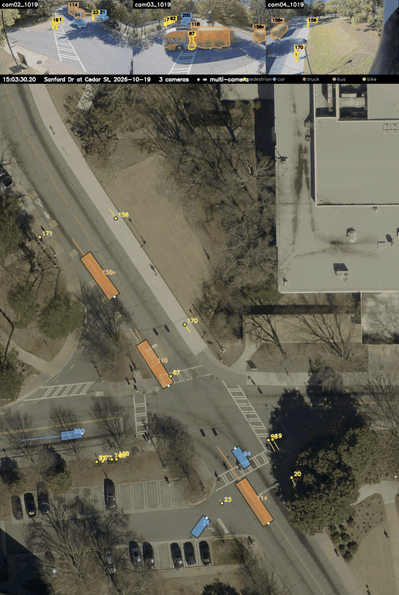

*Thirteen seconds of it. Three camera views along the top, one map below. The same bus, the same
pedestrian, one identity each, wherever they are. The whole two minutes are in
[`figures/fused_demo.mp4`](figures/fused_demo.mp4).*

## 2,971 road users in 71 minutes

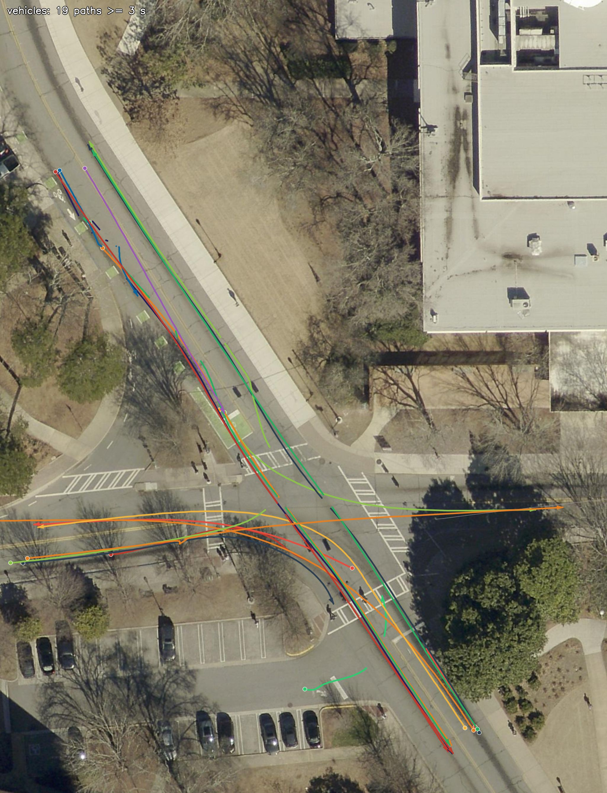

*Every vehicle path in the sample that lasts at least 3 seconds: 19 of them. Dot = where the track
starts, arrow = where it ends.*

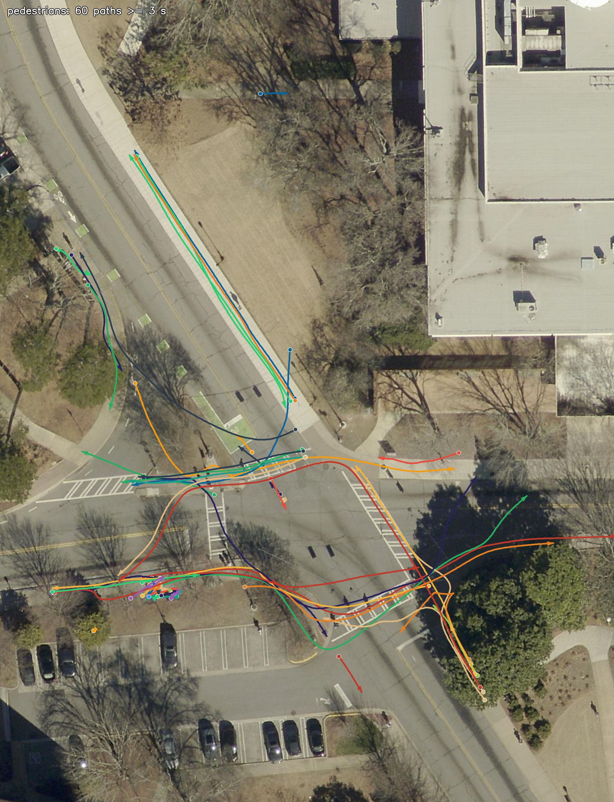

*The same two minutes, pedestrians: 60 paths. Ninety-three road users in a hundred and twenty
seconds, on a university campus at three in the afternoon.*

Over a longer recording the shape of the place appears. These are the same scripts on 71 minutes
from the same afternoon. That recording is not in the repository, only its figures:

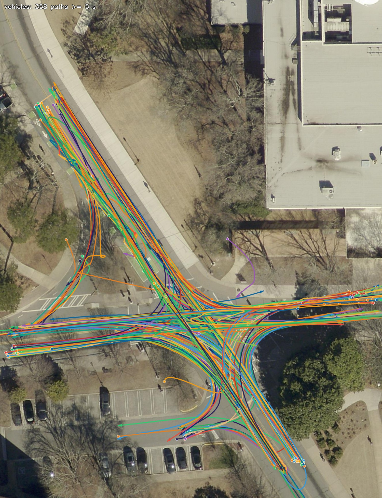

*374 vehicle paths. The lanes, the turning movements and the bus stops draw themselves.*

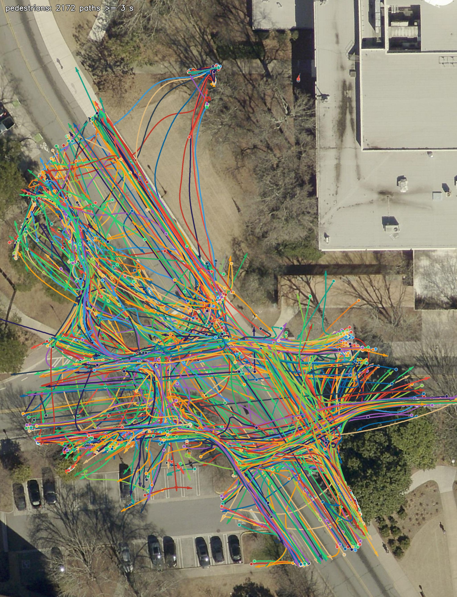

*2,172 pedestrian paths, drawn the same way. This is the point at which lines stop working.*

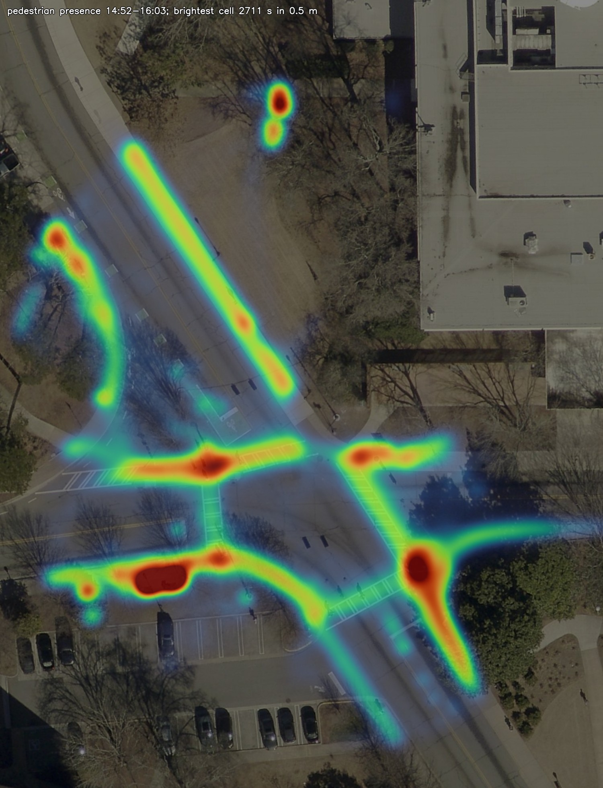

*So here is the same data as presence instead:
how long each half-metre of ground was occupied. The footways, both crossings and the waiting areas
at the corners come out, and so do the benches: the brightest half-metre in the picture collected
45 minutes of the 71, because somebody sat there.*

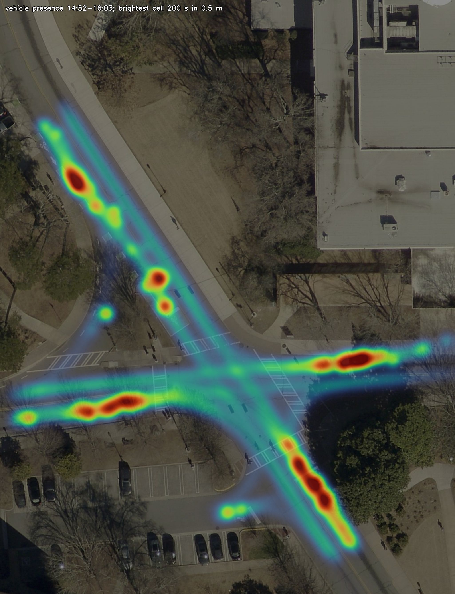

*The same for vehicles. The bright patches are where traffic waits: the stop line, the bus stop, the
queue at the lights.*

## 52 near-misses in 71 minutes, at the bus stop and the south-east corner

Two standard surrogate-safety measures are read off the same trajectories. **Time to collision**
(TTC): at each frame, how long until a moving vehicle's body would reach another road user if both
kept their current velocity. **Post-encroachment time** (PET): when two road users pass through the
same square metre of ground, the time between the first leaving it and the second arriving. A
near-miss is an encounter whose smallest value is at or under 1.5 s.

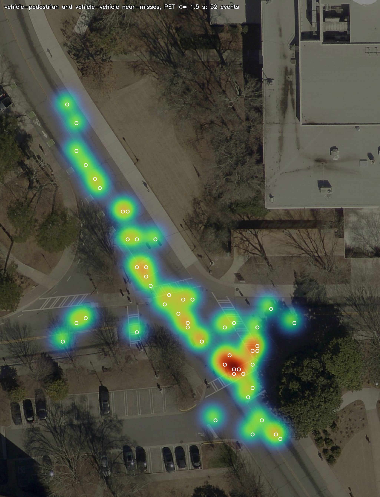

*The 71 minutes, PET at or under 1.5 s: 52 near-misses, 19 between two vehicles, 24 between a
vehicle and a pedestrian, 9 between a vehicle and a bicycle. The hottest ground is the south-east
corner, where the crossing meets the stop line; the string along the north-west arm is the bus stop,
vehicles passing a bus as it pulls out. Vehicles following one another in the same direction under
1.5 s (29 of them) are headways, not conflicts, and are left off the map.*

TTC at or under 1.5 s gives five near-misses in the same 71 minutes, three of them a car arriving
behind a car waiting at the stop line on the east arm, one a car passing a bus pulling out of the
north-west stop at 34 km/h.

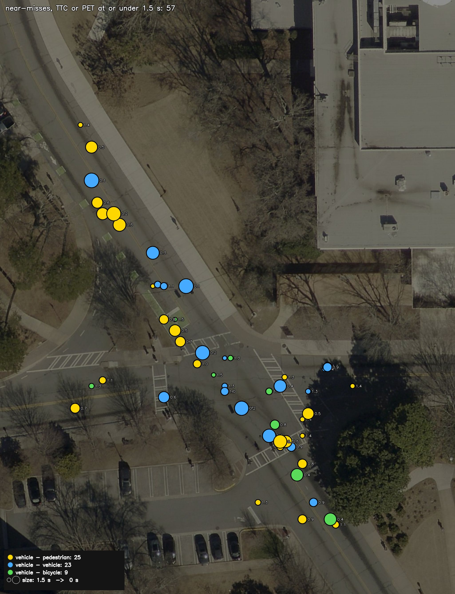

*The same 57 events as markers. Yellow = a vehicle and a pedestrian, blue = two vehicles, green = a
vehicle and a bicycle; the larger the marker, the closer the call, and the number beside it is the
seconds. The vehicle-to-vehicle events line up along the bus stop; the pedestrians gather at the
south-east corner.*

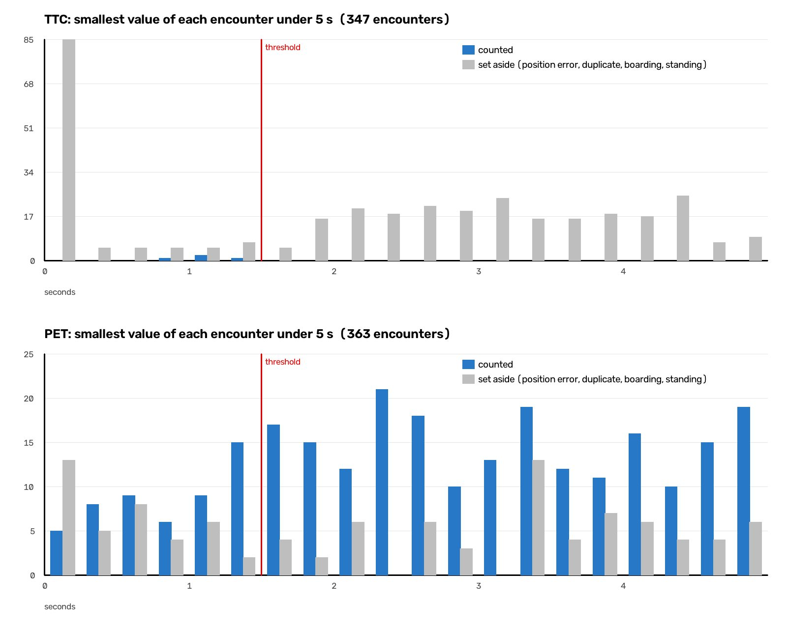

*Every encounter under 5 s by its smallest TTC (top) and PET (bottom). The red line is the 1.5 s
threshold; the grey bars are encounters set aside for the reasons below. Nearly everything at a TTC
of zero is grey: two measured bodies touching is position error, not a collision.*

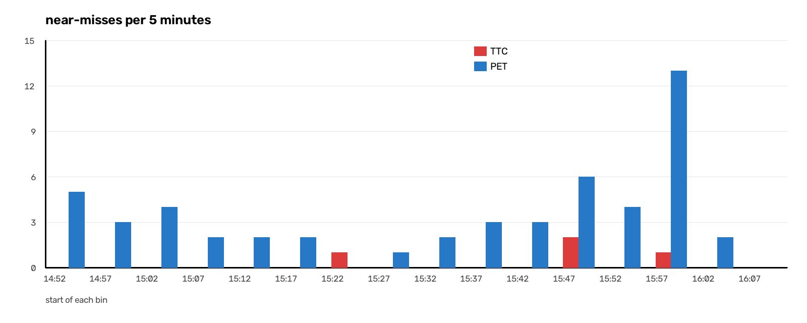

*Near-misses per five minutes, TTC in red and PET in blue.*

Not every small number is a near-miss. Positions carry about a metre of error, so an encounter is
set aside when, as measured, the two bodies touched or overlapped (nobody was hit, so that is the
error, not a collision); when the closest moment falls on a row the merge filled through a gap
rather than on a detection; when the other party is on course for the vehicle's measured edge but
not for its body shrunk by the position error; when the two tracks are one road user seen twice;
when the pedestrian is stepping on or off a bus; or when the vehicle is standing. Each row of
`near_misses.csv` carries the reason, so every exclusion can be checked.

On the two-minute sample the same thresholds give three near-misses, all between vehicles, each
checked against the footage: a pickup passing a bus as it pulls out of the far stop (PET 0.13 s), a
car pulling away from the stop line 0.27 s behind a bus crossing in front of it, and a left turn
across the pickup's path (1.47 s). Five pedestrian encounters with that bus were set aside: the
"pedestrians" were the faces printed on its advertisement.

## Five steps from pixel to metre

1. **A base map.** A county aerial photograph at 6 cm per pixel, carrying real coordinates,
   resampled onto a 4 cm grid in east/north metres from a fixed origin
   (33.94760&deg;N, 83.37630&deg;W).
2. **Calibrate each camera.** Click matching points on a camera frame and on the aerial photograph,
   then solve that camera's position, orientation, focal length and lens distortion by minimising
   the error **on the ground, in metres**, not in pixels. The ground is not assumed flat: a pixel's
   ray is cast onto a real elevation surface built from airborne lidar.
3. **Detect and track in each view.** YOLO26x-seg plus BoT-SORT, every second frame. The foot point
   comes from the segmentation mask, not from the bounding box, because the mask's lowest edge is
   where the tyres meet the road.
4. **Project to the ground.** Each detection becomes a position in metres on that elevation surface.
5. **Merge the views.** One object per road user, however many cameras can see it. Positions are
   combined by inverse-square range, so the nearest camera dominates.

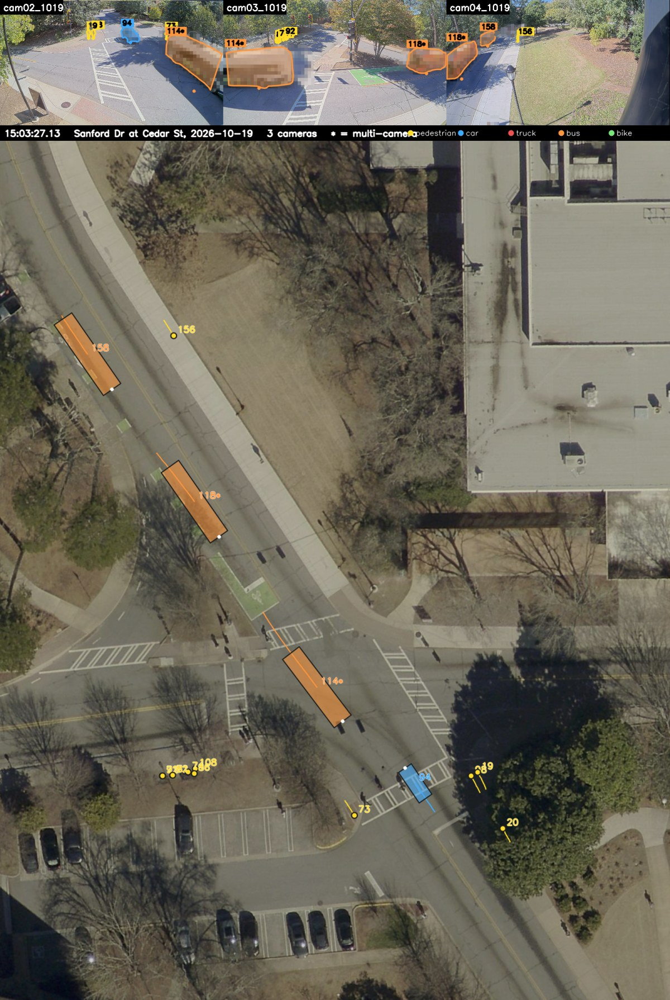

*One frame, large enough to read. Orange = bus, blue = car, red = truck, yellow = pedestrian. A `*`
after a label means two cameras were seeing that object at that moment. Bus 118 is in cam03 and in
cam04, bus 114 in cam02 and cam03, and each appears on the map once.*

Nothing in step 2 tells the solver how high the pole is or where it stands. It works that out from
the clicked points alone, and the answer it returns, 5.4 m, 6.5 m and 6.7 m above the ground it
solved them on, all three within 1.6 m of each other horizontally, is the first thing worth
checking, because it is a real pole you can go and look at.

| camera | points clicked | median residual | 90th percentile |
|---|---|---|---|
| cam02 | 88 | 9 cm | 32 cm |
| cam03 | 101 | 17 cm | 41 cm |
| cam04 | 47 | 32 cm | 71 cm |

Those are how far the clicked points land from where they should, measured on the ground. cam04 is
the worst of the three and also the one with the fewest points; more points is the obvious fix.

A median is one number and it hides everything, so the points are in the repository as pictures. The
same point carries the same number and the same colour in the camera frame and on the aerial
photograph, green within 10 cm and red beyond 50, so you can follow any one of them across and judge
it yourself:

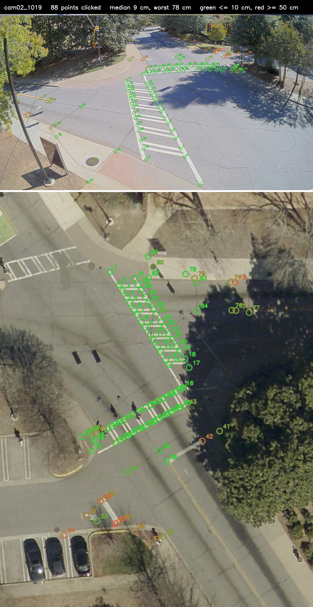

*cam02, 88 points: the ends of the crossing stripes, kerb corners, a drain, the corners of the
brickwork. Almost all green. Its worst point is 78 cm out, and it is 37 m away, where one pixel of
vertical click is already 29 cm of ground, so that is under three pixels of hand.*

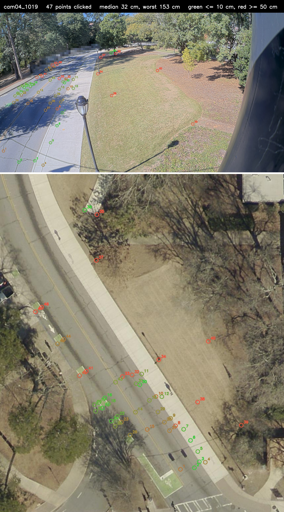

*cam04, 47 points, median 32 cm. It has half as many points as cam02 spread over a longer reach,
out to 57 m against cam02's 40 m, so each one carries more. Its worst, point 34 at 1.53 m, is a
different problem: at that range it is twelve pixels, far more than a hand can slip, so that pair is
almost certainly matched to the wrong feature. A residual table cannot tell those two causes apart.
A picture can.*

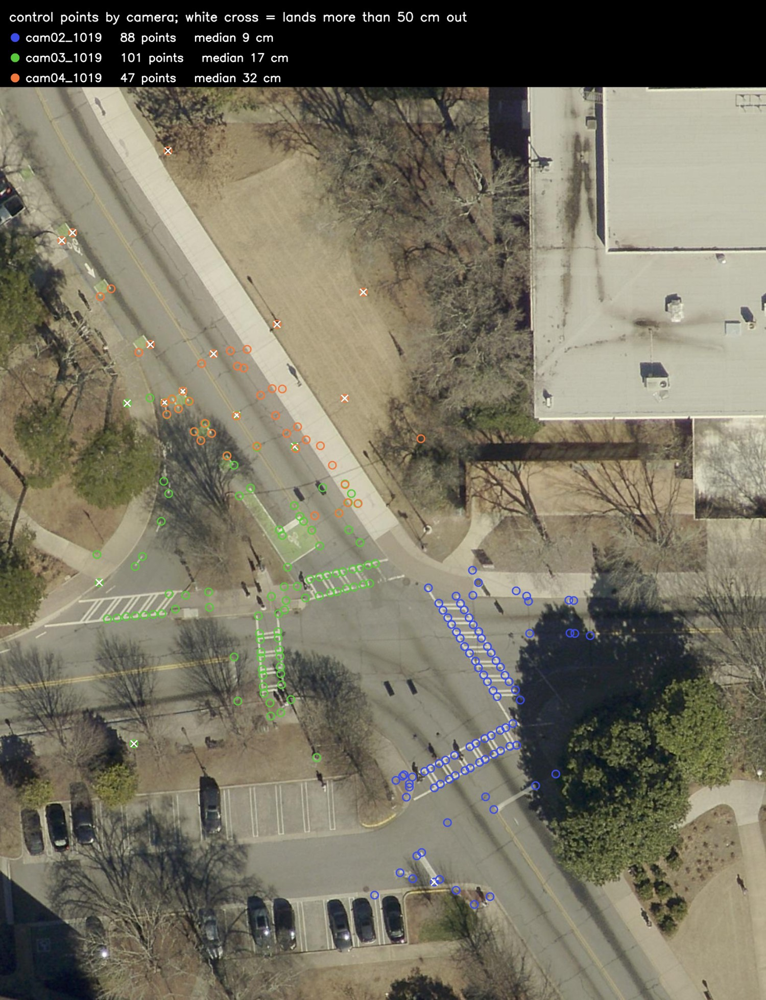

*All three together on the aerial. The points gather on paint, kerbs and drains, because those are
the only things you can identify in a camera frame and in an aerial photograph with any confidence.
Plain tarmac and grass have none, nothing to click, which is why the junction is pinned down far
better than the ground away from it.*

Regenerate these at any time:

```bash
cd pipeline
python plot_control_points.py
```

## 19-59 cm against a survey-grade GNSS track

Measured at this intersection against three independent references, on separate recordings.

| reference | what it is | position error, median / 90% |
|---|---|---|
| GNSS car, pass 1 | a car carrying a survey-grade receiver, driven through | 59 / 108 cm |
| GNSS car, pass 2 | the same car, second pass | 19 / 72 cm |
| pedestrians, set 1 | people seen by a lidar mounted on that car | 71 / 108 cm |
| pedestrians, set 2 | ditto, second recording | 34 / 75 cm |
| other vehicles | the lidar's view of ordinary traffic, matched one-to-one, its track smoothed | 93 / 171 cm |
| buses and trucks | the same, the long vehicles on their own | 84 / 184 cm |

The car that can be checked most precisely sits at 19–59 cm. Ordinary traffic, which the pipeline
was never tuned on and whose real size it has to assume, sits near a metre. That gap is a position
error rather than a heading or size error: once a vehicle is moving, its heading agrees with its own
direction of travel to about a degree.

The lidar's own view of a vehicle is one scan every tenth of a second, and the point of the cluster
nearest the car jumps between the bumper and the side as the geometry changes, by about a metre at
the 90th percentile. So each lidar vehicle track is smoothed first (a robust straight line through
the half-second around each scan, outliers dropped) and the camera is scored against the smoothed
track; against the raw scans the same vehicles read 108 / 197 and 95 / 194 cm. The pedestrian and
GNSS rows need no such step: their tracks move by 1–3 cm between scans.

## Running it

```bash
pip install -r requirements.txt
```

Steps 2, 4 and 5 need nothing beyond numpy, scipy and OpenCV. Step 3 also needs `ultralytics` and a
PyTorch build matching your CUDA version. See the note in `requirements.txt`.

The sample already contains the output of step 3, so the fusion and the rendering run on their own:

```bash
cd pipeline
python fuse_tracks.py --clipdir ../sample --cams cam02_1019,cam03_1019,cam04_1019
python render_fused.py --clipdir ../sample --cams cam02_1019,cam03_1019,cam04_1019 \
    --start 15:02:07 --date 2026-10-19 --lot-file ../calibration/lot_sanford_cedar.json
```

To redo the detection and tracking as well, which takes a few minutes per view on a GPU and considerably
longer on a CPU, run step 3 first. The weights download themselves on first use:

```bash
python track_clip_seg.py --video ../sample/cam02_1019.mp4 --out ../sample/cam02_1019
python track_clip_seg.py --video ../sample/cam03_1019.mp4 --out ../sample/cam03_1019
python track_clip_seg.py --video ../sample/cam04_1019.mp4 --out ../sample/cam04_1019
```

To get the trajectories as data rather than as a video:

```bash
python export_tracks.py --fused ../sample/fused.csv --out ../out \
    --start 15:02:07 --date 2026-10-19 --lot-file ../calibration/lot_sanford_cedar.json
```

which writes one row per object per frame, with wall-clock time, latitude and longitude, and
aerial-image pixel beside the metres, plus a line per trajectory in `tracks_summary.csv` giving its
duration, path length, mean and top speed, and both endpoints, and the two trajectory figures.

A vehicle is drawn only where its position behaves like a vehicle: on the lane network, and
turning no tighter than its body can. The lane network is learned from the traffic itself, one hour
of it, and shipped as `calibration/lane_field_sanford_cedar.json`; to rebuild it from a longer
recording:

```bash
python build_lane_field.py --tracks ../out/tracks.csv --out ../calibration/lane_field_sanford_cedar.json
```

Over a long recording the lines overlap into a tangle, and presence reads better than paths:

```bash
python density.py --tracks ../out/tracks.csv --out ../out/density_pedestrians.png
python density.py --tracks ../out/tracks.csv --out ../out/density_vehicles.png --vehicles
```

And the near-misses, from the same file:

```bash
python safety.py --tracks ../out/tracks.csv --out ../out/safety --start 15:02:07
```

which writes `near_misses.csv` (one row per encounter under 5 s, with the measure, the two parties,
the time, the place and why it was or was not counted), `safety_summary.txt`, and the two heat maps.
`--ttc` and `--pet` set the thresholds; both default to 1.5 s.

## Four folders

| | |
|---|---|
| `pipeline/` | the five steps, plus the export, the renderer, the presence maps and the near-miss analysis |
| `calibration/` | the solved camera models, the clicked control points, the base map, the ground surface, the lane network |
| `sample/` | two minutes, three cameras, 2026-10-19 15:02:07, with step 3 already done |
| `figures/` | the pictures above, and the sample as video |

A camera's solved model lives in `calibration/<camera>_fit_pnp/cam.json`. `_fit_pnp` is the default
value of `--fit-suffix`, so several solutions for one camera can sit side by side and be chosen on
the command line.

## Known limits

**The "pedestrian" figure includes cyclists.** The code splits road users in two: cars, motorcycles,
buses and lorries on one figure, everything else on the other. A cyclist is detected as a bicycle and
so lands with the pedestrians. Over the 71 minutes that is 68 bicycles among 2,517 pedestrians.

**Parking is not traffic.** A car standing in a bay is still detected every frame, and its solved
centre drifts a metre or two as the cameras see more or less of it. Drawn, it looks like a vehicle
wandering around a car park. `calibration/lot_sanford_cedar.json` marks the bays by hand, and
vehicles inside them are left out; the drive in and the drive out are kept, because those do affect
the junction.

**A standing vehicle has no direction.** Heading is read from the track, so it means nothing until
the vehicle has actually moved a couple of metres. A car creeping into a bay keeps whatever heading
it last had out on the aisle, which is why it is better not to draw it at all than to draw it
pointing the wrong way.

**Two road users can end up as one.** The merge links camera tracks that run close together, and a
chain of such links can join vehicles that were never near each other. Two rules catch the cases
seen so far: an occlusion bridge joins a vehicle only to one of its own class, and two vehicle
objects on top of each other are taken for one vehicle only when their classes agree. On the
two-minute sample no object is now built from tracks of different classes and no object jumps
between two places; over 71 minutes, 2 of 604 vehicle objects still mix a bus track with a car
track, and none jumps.

**The cameras agree with the map, not with each other.** Each is solved against its own control
points, so nothing forces two of them to place the same physical point identically. On this
recording two cameras differ by 0.6 m to 1.2 m on the same pedestrian's feet. Only about one row in
ten has two cameras at all, so single-camera accuracy is what mostly matters, but the difference
does show as a small step when an object hands over from one camera to the next.

**The base map is a photograph of one particular morning.** The vehicles parked in it are from that
morning and have nothing to do with the footage. Three that were standing on the roadway have been
painted out; everything else is as flown.

## Site

Sanford Drive at Cedar Street, University of Georgia, Athens. The cameras are on one pole on the
corner; three of them are calibrated here. The sample is a Monday afternoon.
